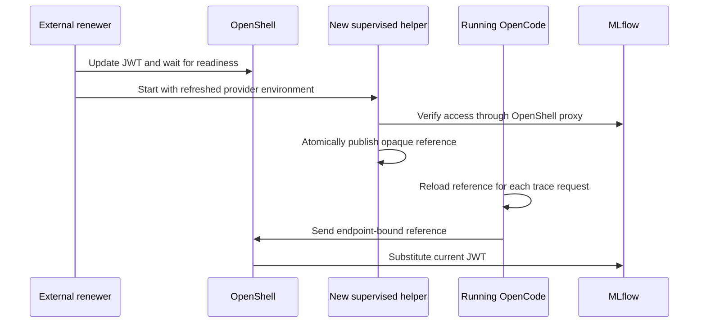

# Renew MLflow credentials without routine sandbox restarts

## Contents

1. Mechanism and limits
2. Prepare and build the patched image
3. Roll out a repair sandbox once
4. Run the external renewal loop
5. Prove rotation after expiry
6. Failure handling and rollback

## 1. Mechanism and limits

OpenShell 0.1.2 ordinary static-provider updates give **new processes** a new revision-scoped opaque reference. The already running OpenCode process retains its old environment. MLflow 3.14.0's OSS TypeScript auth also precomputes the header. Provider update/readiness alone therefore does not solve a long-running server's expiry.

This local adaptation changes MLflow's **headers provider**, which the trace API and proxied artifact clients call for each request. It loads `/sandbox/.opencode-setup/mlflow-reference.json` afresh. The document contains an opaque OpenShell reference and expiry metadata, never a Kubernetes JWT. The patch rejects missing, malformed, symlinked or expired files instead of falling back to the old header.



The renewer uses `oc create token` outside the sandbox. The supervisor holds the real token and resolves the handle only at the authorized MLflow endpoint. A short helper process can end after publishing; the reference is a supervisor-resolved credential reference, not the helper's process environment pointer. Keep MLflow hostname, port, path, profile and provider attachment unchanged during ordinary renewal. Detachment, boundary changes, incompatible upgrades and gateway/runtime replacement require separate requalification.

**One-time rollout is necessary** to load the patched client/launcher. Subsequent successful renewal cycles do not stop/start OpenCode, its sandbox or its forward. This does not promise uninterrupted export during a control-plane outage, auth outage, failed publication or already-expired in-flight request. Renew with a margin and prove actual delivery after the old expiry. No automatic retry of non-idempotent trace writes is added by this patch.

The normal OpenShell OAuth/AWS refresh mechanisms are separate features; Kubernetes TokenRequest is not one of those OAuth grant strategies. Do not invent a `kubernetes` refresh strategy or copy a `stable_placeholder` option from unreleased documentation into the pinned 0.1.2 profile.

## 2. Prepare and build the patched image

Use the extracted **2026-11-09 deployment bundle** from this conversation, including `assets/openshell/`. If you have only its portable Markdown, run its extraction block first. The new preparation helper checks source hashes and refuses an unreviewed baseline; do not bypass the guard. Compare local changes and port them intentionally when the baseline differs.

Keep the variables from `repair.md`; choose a new build directory and image tag. These commands prepare/build only; no existing workload is replaced.

```bash
python3 "$REPAIR_SKILL_DIR/scripts/prepare_image.py" \
  --baseline "$DEPLOY_SKILL_DIR" --out "$LAB_DIR/repair-image"
export BASE_TAG=quay.io/aipcc/agentic-ci/openshell:0.3.27
export BASE_IMAGE="${BASE_TAG%:*}@$(skopeo inspect --format '{{.Digest}}' "docker://$BASE_TAG")"
export REPAIR_TAG=YOUR_REGISTRY/YOUR_PROJECT/opencode-openshell:1.18.3-mlflow3.14-refreload
podman build --platform linux/amd64 --build-arg BASE_IMAGE="$BASE_IMAGE" \
  -t "$REPAIR_TAG" "$LAB_DIR/repair-image"
podman push "$REPAIR_TAG"
export REPAIR_IMAGE="${REPAIR_TAG%:*}@$(skopeo inspect --format '{{.Digest}}' "docker://$REPAIR_TAG")"
podman run --rm --entrypoint /opt/opencode/bin/opencode "$REPAIR_IMAGE" --version
podman run --rm --entrypoint /usr/bin/readlink "$REPAIR_IMAGE" -f /usr/bin/python3
```

The Containerfile uses the base's `microdnf`, installs the fixed native OpenCode binary and Python >=3.10, builds MLflow at v3.14.0 and patches its exact source before compilation. Verify the Python executable still matches the reviewed policy. Pin other mutable build images to approved digests in controlled CI. No package installation is needed at runtime.

Check the compiled module in the new image:

```bash
podman run --rm --entrypoint /bin/sh "$REPAIR_IMAGE" -ec '
  test "$(readlink -f /opt/mlflow-ts/node_modules/@mlflow/core)" = /opt/mlflow-ts/core
  grep -q OPENSHELL_REFERENCE_RELOAD_V1 /opt/mlflow-ts/core/dist/auth/index.js
'
podman run --rm --entrypoint /usr/bin/python3 "$REPAIR_IMAGE" -c \
  'import ast,pathlib; [ast.parse(p.read_text()) for p in pathlib.Path("/opt/opencode-launch").glob("*.py")]'
```

Never make `/opt` writable for the running agent. Retain the approved supervisor CA image from the deployment; this repair does not change or replace it.

## 3. Roll out a repair sandbox once

Use a **new sandbox and a separate MLflow provider** so the original can be retained for rollback. OpenShell 0.1.2 does not expose a general in-place sandbox image replacement in this workflow; do not patch controller-generated pods or delete/recreate the original name to conceal a migration. Preserve its PVC, original provider and sessions. The new sandbox starts with its own state; session history is not automatically migrated.

The existing gateway must already be qualified, trust the MLflow service CA, and have the reviewed `opencode-rhoai-mlflow` profile. Review that profile, base policy and exact trace collection rules as in `repair.md`. Use the original MiniMax provider and its unchanged Secret-backed model settings. Check the dedicated tracer identity/binding before issuing a token.

```bash
export OLD_SANDBOX="$SANDBOX"
export SANDBOX=opencode-repaired
oc -n "$NS" get sa opencode-tracer
oc auth can-i create serviceaccounts/opencode-tracer --subresource=token -n "$NS"
oshell profile export opencode-rhoai-mlflow -o yaml > "$LAB_DIR/mlflow-profile-review.yaml"
oshell sandbox list
oshell provider list
python3 "$REPAIR_SKILL_DIR/scripts/renew_mlflow.py" --create-provider
```

The create-only helper creates `opencode-mlflow-hot`, using the imported profile; it neither overwrites an existing provider nor prints the JWT. If creation partly succeeds, inspect the exact object and ownership before retrying. Do not attach both the original and new MLflow providers to the repair sandbox: they declare the same environment key.

Use the reviewed `generated/policy.yaml` from the deployment, ensuring the actual Python path matches. Keep `--no-auto-providers`. The foreground launcher first waits for runtime/login configuration, then for the fresh reference document.

```bash
oshell sandbox create --name "$SANDBOX" --from "$REPAIR_IMAGE" \
  --provider opencode-minimax --provider opencode-mlflow-hot --no-auto-providers \
  --policy generated/policy.yaml --cpu 2 --memory 4Gi --detach -- \
  python3 /opt/opencode-launch/start.py
oshell sandbox exec -n "$SANDBOX" --no-login-shell -- id
python3 "$DEPLOY_SKILL_DIR/scripts/credentials.py" stage
python3 "$REPAIR_SKILL_DIR/scripts/renew_mlflow.py" --bootstrap
oshell logs "$SANDBOX" -n 80
```

Wait for exec readiness before staging. Each launcher wait is bounded to ten minutes; a timeout is recovered by starting the retained new sandbox and promptly staging/bootstrap again. The publisher first validates access to the experiment lookup API through the correct workspace; then the foreground launcher creates/reuses the experiment and starts OpenCode. Probe success is still not trace-export acceptance.

Bring in a reviewed code export to a fresh destination:

```bash
oshell sandbox upload "$SANDBOX" "$LAB_DIR/repo-export/app" /sandbox/workspace
```

Preserve uncommitted input changes separately and review the transferred files. Use `AGENTS.md` and the same toolchain/tests. Do not blindly upload credential files or copy live SQLite/WAL files. The old sandbox retains history; use a supported, validated export/backup procedure if history migration is required.

Inspect local forwards. If the old sandbox owns this control host's 4096 forward, stop **only that forward**, then switch to the new sandbox:

```bash
oshell forward list --output json
# Run the next line only when the old sandbox owns the listed local 4096 forward.
oshell forward stop 4096 "$OLD_SANDBOX"
oshell forward start 127.0.0.1:4096 "$SANDBOX" --background
python3 "$DEPLOY_SKILL_DIR/scripts/credentials.py" smoke --dir /sandbox/workspace/app
python3 "$DEPLOY_SKILL_DIR/scripts/credentials.py" attach --dir /sandbox/workspace/app
```

Use another terminal for the attach session; keep the gateway control tunnel active. The original server itself need not be stopped for this local forward switch.

## 4. Run the external renewal loop

From a trusted POSIX management host (Linux/macOS, Python 3.10+) with the same gateway/workspace/client configuration and valid `oc` authentication, run once:

```bash
python3 "$REPAIR_SKILL_DIR/scripts/renew_mlflow.py"
```

Require `event=renewed` and `server_unchanged=true`. It issues a token for the expected ServiceAccount subject, checks the **actual returned expiry**, updates only `MLFLOW_TRACKING_TOKEN`, waits for readiness, runs a new supervised publisher, probes MLflow and atomically replaces the opaque reference. No token values, opaque references or subprocess output are printed.

For continuing operation, keep this loop running in a supervised management terminal/service **outside the agent sandbox**:

```bash
python3 "$REPAIR_SKILL_DIR/scripts/renew_mlflow.py" --loop
```

The loop renews halfway through the remaining issued lifetime, capped at 30 minutes between attempts; failures are retried after 60 seconds and logged as structured events. A local file lock prevents another writer on the same control host; deploy exactly one writer overall. Do not combine the old `credentials.py rotate-mlflow` restart procedure with this loop or manually update the same provider concurrently.

A laptop sleeping, lost `oc port-forward`, expired control-host login, unavailable OpenShell gateway or a stopped loop eventually exhausts the old JWT. For unattended service, run the same helper under the organization's process supervisor with durable gateway connectivity and an approved dedicated identity. This skill supplies the loop, not a production scheduler, identity bootstrap or availability guarantee. Monitor `renewal_failed` and the last successful expiry; alert well before that expiry. Do not hide failure by creating a permanent Kubernetes token Secret.

The external identity needs TokenRequest creation only for `opencode-tracer` (plus its normal gateway access). A narrowly scoped Role for an existing approved automation identity is:

```yaml
apiVersion: rbac.authorization.k8s.io/v1
kind: Role
metadata:
  name: opencode-tracer-token-issuer
  namespace: opencode-agents
rules:
  - apiGroups: ['']
    resources: ['serviceaccounts/token']
    resourceNames: ['opencode-tracer']
    verbs: ['create']
```

Use the actual namespace. Bind it only to the chosen external automation identity after reviewing ownership. Token issuance for the tracer conveys that tracer's MLflow rights; do not grant other token subjects or namespace `edit`. The dedicated gateway client certificate is powerful—do not place it, the issuer's kubeconfig, or real TokenRequest credentials inside the sandbox. Reuse approved OIDC/RBAC for managed gateways.

## 5. Prove rotation after expiry

Run this acceptance during a controlled observation window. The loop can run without user interaction while a marked task continues, but do not promise traces lost during an earlier outage can be recovered automatically.

1. Capture the initial successful token's expiry from the helper output and the server identity. Use no raw credential dumps.
2. Send a marked prompt via the same attached server and require the matching trace.
3. Renew once. Require publication success and an unchanged server identity; keep the same sandbox, process and client connection.
4. Wait until **after the old JWT's actual expiry**, with the loop still succeeding. Send another marked prompt, require a new matching MLflow trace and compare identity again. This is the decisive test against an exporter still using the old environment.

```bash
oshell sandbox exec -n "$SANDBOX" --no-login-shell -- \
  python3 /opt/opencode-launch/server_identity.py > "$LAB_DIR/server-before.json"
python3 "$DEPLOY_SKILL_DIR/scripts/credentials.py" smoke --dir /sandbox/workspace/app
oshell sandbox exec -n "$SANDBOX" --no-login-shell -- \
  python3 /opt/opencode-launch/check_trace.py PASTE_FIRST_MARKER
python3 "$REPAIR_SKILL_DIR/scripts/renew_mlflow.py"
# After the previous JWT's actual expiry, with successful renewal still running:
python3 "$DEPLOY_SKILL_DIR/scripts/credentials.py" smoke --dir /sandbox/workspace/app
oshell sandbox exec -n "$SANDBOX" --no-login-shell -- \
  python3 /opt/opencode-launch/check_trace.py PASTE_SECOND_MARKER
oshell sandbox exec -n "$SANDBOX" --no-login-shell -- \
  python3 /opt/opencode-launch/server_identity.py > "$LAB_DIR/server-after.json"
cmp "$LAB_DIR/server-before.json" "$LAB_DIR/server-after.json"
```

Run the manual renew-once command with the loop stopped, then restart the loop; do not start a second competing writer. The identity comprises PID, process start ticks and PID-namespace identity, rather than PID alone. Record the sandbox identity as well. For a shorter qualification test, use `--duration=15m` for the initial issuance/renewal and compare the actual expiry; the API may return a different duration. The helper refuses tokens with ten minutes or less remaining. Do not wait out token expiry without a functioning renewal path.

Also verify: MiniMax still works; anonymous `/session` access fails; arbitrary destinations and unapproved binaries remain denied; `/opt` remains read-only under Landlock; the reference file contains only the expected opaque-handle form; and the image's TypeScript patch marker is present. Do not print the reference itself to prove its type.

## 6. Failure handling and rollback

| Failure | Behavior / response |
|---|---|
| Provider wait fails | No publication is requested. Some gateway state may already have changed; inspect readiness and retry normally. Do not restart the server as part of the renewal loop. |
| New supervised probe fails | The previous file remains in place. Check policy, TLS, workspace/RBAC and the new provider environment. A provider update alone is not success. |
| Publication file is missing/invalid/expired | The client rejects export instead of reverting to the old environment credential. Restore successful renewal; do not replace the file with a real JWT. |
| Server identity changes | The helper reports failure; investigate external restarts or another operator. It never invokes stop/start/delete. |
| Controller authentication expires | Renew the approved control identity outside the sandbox. The loop cannot extend its own Kubernetes/gateway authority. |
| New image/plugin fails | Stop the new local forward, reconnect to the preserved original sandbox and retain both PVCs. The original token workflow still needs its planned idle restart on expiry. |

Do not detach/revoke the repair provider while the server is using it. An existing request may retain a reference for the duration of that request; renew well ahead of expiry. MiniMax credential rotation, CA rotation, image upgrades and changes to credential boundaries can still need a planned rollout. Leave the source Secret, original deployment, profiles and data intact unless their cleanup is explicitly requested.
